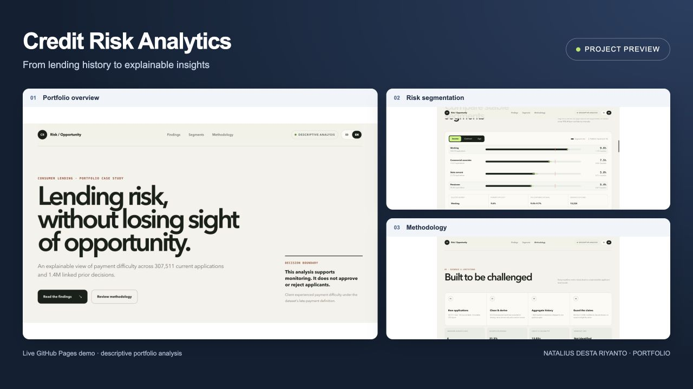

# Credit Risk & Lending Portfolio Analytics



An end-to-end portfolio case study that turns 307,511 current lending applications
and linked prior decisions into an explainable risk-monitoring experience.

[Live dashboard](https://desta-data-analytics.github.io/credit-risk-analytics/) · [Source repository](https://github.com/Desta-data-analytics/credit-risk-analytics)

## The business question

How can a consumer-finance risk team identify portfolio segments associated with
payment difficulty while preserving opportunity for applicants who are likely to
repay?

This project is descriptive decision support. It is **not** an approval model and
does not recommend automated eligibility rules.

## Dataset, scope and published results
The input is [Risk Analytics in Banking on Kaggle](https://www.kaggle.com/datasets/sabarostami/risk-analytics-in-banking). Download the files under their source terms and place `application_data.csv` and `previous_application.csv` in `data/raw/dataset/`. Raw inputs are excluded from Git; the dashboard ships curated aggregates, not applicant-level records.

The checked-in full-data dashboard artifact contains:

| Measure | Value | Meaning |
| --- | --- | --- |
| Current applications | 307,511 | One row per current applicant |
| Payment-difficulty outcomes | 24,825 (8.07%) | Source `TARGET = 1` |
| Linked prior decisions | 1,413,701 | Prior rows matching current applicant IDs |
| Applicants with linked history | 291,057 (94.65%) | At least one matched prior decision |
| Prior approval rate | 62.68% | Approved decisions divided by linked prior decisions |

These values come from `dashboard/src/data/portfolio.json`. A sample pipeline run replaces the artifact with sample results; do not present sample outputs as full-data findings. The prior source contains more rows than the matched analytical population, so raw and linked prior counts differ.

## Pipeline walkthrough
1. Read selected application columns and validate the current-applicant key.
2. Clean sentinel values and derive age, employment tenure and affordability ratios.
3. Read prior decisions in 200,000-row chunks, keep IDs in the current population and aggregate counts and credit totals.
4. Join with `validate="one_to_one"`; reject duplicate keys and non-binary outcomes.
5. Write the applicant model, column-level quality report and portfolio summary using temporary files followed by replacement.
6. Export segment aggregates and Wilson intervals to dashboard JSON.
7. Build a static Next.js dashboard for GitHub Pages.

Each artifact is replaced atomically, but the entire set is not a transactional database snapshot. The application is a historical analytical dashboard, not a live lending service.

## What makes the analysis trustworthy

- One-row-per-applicant analytical model with validated keys
- Chunked aggregation of the 1.67M-row prior-application source
- Employment sentinel `365243` converted to missing, not treated as tenure
- Affordability ratios computed only when annual income is positive
- Income, contract and age segment comparisons suppress groups below 500 applications; affordability distribution export uses a minimum of one observation
- 95% Wilson confidence intervals reported with segment rates
- Sensitive and historical-policy fields treated as monitoring context, not rules
- Monetary values described as source currency units because the dataset does not
  identify a currency

## Architecture

```text
Immutable CSV sources
        ↓
Python cleaning + feature engineering
        ↓
Applicant-level analytical model
        ↓
Portfolio-safe JSON aggregates
        ↓
Next.js analytical dashboard
```

## Repository map

```text
src/                    Python pipeline, transformations, metrics, export
tests/                  Data-contract and statistical-guardrail tests
dashboard/              Next.js 16 + React 19 analytical portfolio UI
legacy/                 Archived Streamlit prototype (not the main entrypoint)
data/raw/               Original Kaggle files (ignored by Git)
data/processed/         Generated analytical artifacts (ignored by Git)
```

## Run the data pipeline

```bash
python -m venv .venv
source .venv/bin/activate
pip install -r requirements.txt
python -m src.pipeline
pytest -q
```

The pipeline atomically replaces generated artifacts and refreshes
`dashboard/src/data/portfolio.json`. For a fast development build:

```bash
python -m src.pipeline --sample-rows 50000
```

## Run the portfolio dashboard

```bash
cd dashboard
npm install
npm run dev
```

Production verification:

```bash
npm run lint
npm run build
```

## Free deployment on GitHub Pages

The dashboard is configured as a static Next.js export. Every push to `main`
runs tests, lint, and build checks before deploying `dashboard/out` through the
GitHub Pages environment.

The live project demo is published at https://desta-data-analytics.github.io/credit-risk-analytics/.
The build automatically uses a repository base path for project Pages and the
root path for account or organization Pages.

## Core definitions

- **Payment difficulty:** `TARGET = 1`, using the source dataset's late-payment
  definition. It is not relabeled as default.
- **Credit-to-income:** current requested credit divided by annual income.
- **Annuity-to-income:** current annual annuity divided by annual income.
- **Prior approval rate:** approved linked prior applications divided by all
  linked prior decisions for applicants in the current model.
- **Risk index:** segment payment-difficulty rate divided by the portfolio rate.

## Limits

The dataset has no identified currency or observation date, so the project makes
no currency conversion, time-trend, expected-loss, or causal claims. Prior lending
decisions may encode historical policy bias. Before operational use, findings
would require temporal validation, fairness review, stability monitoring, and
analysis that controls for confounding variables.

## Dashboard use and project outputs
Start with the portfolio baseline, compare segment rates and intervals, then inspect linked lending outcomes and data-quality context. A high risk index identifies an association worth investigating; it does not justify excluding that group from credit.

| Artifact | Location | Purpose |
| --- | --- | --- |
| Applicant model | `data/processed/applicant_risk_model.csv` | Internal derived applicant-level analysis |
| Quality report | `data/processed/data_quality.csv` | Missingness, types and distinct counts |
| Portfolio summary | `data/processed/portfolio_summary.json` | Core descriptive metrics |
| Public aggregate data | `dashboard/src/data/portfolio.json` | Static UI data contract |

## Validation and reproducibility
`tests/test_transform.py` exercises cleaning and feature contracts. `tests/test_portfolio_export.py` checks aggregation and statistical guardrails. Tests use fixtures and do not require distributing the raw Kaggle data. CI validates the Python suite and dashboard lint/build; reproducing the full historical figures additionally requires the original input files.

The legacy Streamlit directory is retained for historical context. The supported portfolio entrypoint is `dashboard/`. No model training, applicant scoring endpoint, automated approval decision or real-time data refresh is implemented.
